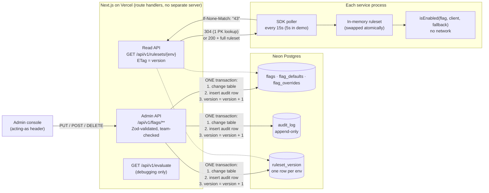

# SistemSaya Flags

A working demo of SistemSaya's internal feature-flag service: an admin API and console where owning teams change flags, a TypeScript SDK that services embed, and a live "billing service" that shows changes arriving within one poll interval. It also shows what happens when the flag API goes down.

The demo is one page with three panels:

| Panel | What it shows |
| --- | --- |
| **Toolbar** (top) | One environment switch for both panels, an "acting as" identity picker (simulated auth), and a 6-step "Try it" checklist that ticks itself off as you demo |
| **Flags** (left) | The flag list, then for the selected flag a default switch and a `Default · ON · OFF` control per client. Prod changes ask for a reason (one-click suggestions available). Hovering a client row highlights its card; the wrong team gets a visible 403 |
| **billing-service** (right) | The real SDK running in the browser. Five customers' dashboards change invoice design (`billing.new_invoice_design`), theme (`frontend.dark_mode`) and PDF button (`billing.pdf_export_v2`). Cards flash "Updated" when a flag changes them, and tags show where each value came from. "Break things" controls: API outage, restart, emergency override |
| **Under the hood** (bottom right) | A heartbeat of SDK polls (gray `304`, green `200`, red error), the version in memory, a staleness meter, and the live `audit_log`. After every write a notification follows the change until the service has picked it up ("Live in billing-service 1.5s after saving") |

The app has a left sidebar with one page per area. The top bar (environment, acting as, demo checklist) is shared by every page, and the in-browser service keeps running while you switch pages.

| Page | What it's for |
| --- | --- |
| **Dashboard** (`/`) | Everything above on one screen, for the 3-minute demo |
| **Flags** (`/flags`) | Every flag across dev / staging / prod; click a cell to edit it |
| **Clients** (`/clients`) | Which flags each client has, with a live preview of their dashboard |
| **Services** (`/services`) | The live service at full size, its poll history, and the exact ruleset JSON it holds |
| **Audit log** (`/audit`) | Every change, filterable by environment, flag and text |
| **How it works** (`/how-it-works`) | A visual walkthrough of the design |

## Architecture



**Write path.** Every write (default, override, archive, create, metadata) runs in one Postgres transaction. It changes its table, inserts an `audit_log` row and runs `UPDATE ruleset_version SET version = version + 1` for each environment it affects. That `UPDATE` takes a row lock, so concurrent writers to one environment are serialised and versions have no gaps and no duplicates. Each audit row also stores the version it produced.

**Read path.** Services poll `GET /api/v1/rulesets/{env}` with `If-None-Match`. When nothing has changed, the server does one primary-key lookup on `ruleset_version` and returns an empty `304`. When something has changed, one SQL statement builds the whole ruleset as JSON. Because the version and the data come from the same snapshot, a payload can never carry a version that doesn't match its contents.

**Evaluation order** (in `src/lib/sdk/evaluate.ts`, shared by the SDK and `/evaluate`):
`local emergency override → client override → environment default → in-code fallback`

## Run it locally

You need Node 20+ and nothing else.

```bash
npm install
npm run dev
```

Then open http://localhost:3000.

When `DATABASE_URL` is unset, the app runs against an **embedded Postgres** ([PGlite](https://pglite.dev), Postgres compiled to WASM). It is stored in `./.data/pglite` and migrates and seeds itself on first use. The SQL, migrations, triggers and transactions are the same as on Neon.

To use a real Neon database instead:

```bash
cp .env.example .env    # then paste your Neon connection string into DATABASE_URL
npm run db:migrate      # applies drizzle/*.sql
npm run db:seed         # resets the demo data (safe to re-run)
npm run dev
```

Other scripts:

| Script | What it does |
| --- | --- |
| `npm test` | Vitest: evaluation order, SDK polling, ETag/304 and permission checks. The integration tests run against in-memory PGlite |
| `npm run build` | Production build |
| `npm run db:generate` | Generate a new migration after editing `src/db/schema.ts` |
| `npm run typecheck` / `npm run lint` | Type-check / lint |

## Deploy on Vercel + Neon

1. Push this repository to GitHub and import it in Vercel. The framework preset is Next.js; no settings need changing.
2. In the Vercel project, open **Storage → Marketplace → Neon** and create a database connected to the project. The integration sets `DATABASE_URL` for every environment.
3. Run the migration and seed once against that database from your machine:
   ```bash
   vercel env pull .env        # brings DATABASE_URL down locally
   npm run db:migrate
   npm run db:seed
   ```
4. Redeploy, or trigger the first deploy, and open the URL.

If `DATABASE_URL` is missing on Vercel, the API returns a clear error rather than quietly falling back to the embedded database.

## API

Writes need the simulated auth headers `x-acting-user` and `x-acting-team`. Every prod change needs a `reason` of at least 3 characters. A team can only change flags it owns; anything else gets a `403`.

| Method & path | Body | Notes |
| --- | --- | --- |
| `GET /api/v1/flags` | | `?status=active\|archived\|all` |
| `POST /api/v1/flags` | `{ key, description, expiresAt?, defaults?, reason? }` | Key must start with the acting team (`billing.…`) |
| `GET /api/v1/flags/{key}` | | |
| `PATCH /api/v1/flags/{key}` | `{ description?, expiresAt?, ownerTeam?, reason? }` | `key` is immutable (API and DB trigger) |
| `POST /api/v1/flags/{key}/archive` | `{ reason }` | Removes the flag from every ruleset |
| `PUT /api/v1/flags/{key}/env/{env}/default` | `{ enabled, reason }` | |
| `PUT /api/v1/flags/{key}/env/{env}/clients/{clientId}` | `{ enabled, reason }` | Add or update an override |
| `DELETE /api/v1/flags/{key}/env/{env}/clients/{clientId}` | `{ reason }` (or `?reason=`) | Client goes back to the default |
| `GET /api/v1/flags/{key}/audit` · `GET /api/v1/audit` | | `?limit=&env=` |
| `GET /api/v1/rulesets/{env}` | | `ETag: "<version>"`, `Cache-Control: no-store`, `304` on match |
| `GET /api/v1/evaluate?flag=&client=&env=` | | Debugging aid |

Errors always look like `{ "error": { "code", "message", "details" } }`. Zod messages name the field, for example `Invalid query string — env: environment must be one of dev, staging, prod`.

## SDK

```ts
import { createFlagClient } from "@/lib/sdk";

const flags = createFlagClient({ baseUrl: "https://flags.sistemsaya.internal", env: "prod" }); // pollIntervalMs = 5000

if (flags.isEnabled("billing.new_invoice_design", clientId, /* fallback */ false)) {
  renderNewInvoice();
}
```

- `isEnabled` / `evaluate` read memory only; `evaluate` also tells you which rule produced the value.
- The poller uses `setTimeout`, so polls never overlap. It sends `If-None-Match`. On a `200` it validates and builds the complete new map, then swaps it in with one assignment. On a `304` it only records that the copy is still current. On an error it keeps the last good copy.
- An unknown flag logs one warning per key and returns the fallback.
- `getState()` exposes the version, `lastSuccessfulSync`, the poll log and the emergency overrides. `getStalenessSeconds()` gives staleness. `subscribe()` lets a UI re-render; the demo uses it with `useSyncExternalStore`.
- `setEmergencyOverride(key, true | false | null)` adds a local override that wins over everything.
- The SDK depends only on `fetch` and timers: no React and no Node APIs. Pass `fetch` to inject failures, as the outage switch does.

## Design decisions

**Polling over push.** Each service polls every 15s (5s in the demo).

- *Failure is boring.* If the flag API is down, polls fail and services keep running on the last good copy. Nothing reconnects in a storm when it comes back.
- *Stateless server.* There is no connection registry or fan-out, and no sticky routing. Any instance can answer any poll.
- *Cheap when nothing changes, which is almost always.* A `304` costs one primary-key lookup and no body. 1,000 pods polling every 15s is about 67 req/s of tiny requests.
- *The trade-off is up to one interval of propagation delay.* That's fine for feature flags. For the "turn it off right now" case there is the local emergency override, and it works even when the API is down.

**Why serverless suits polling.** Each poll is a short, independent request/response, which is exactly the workload serverless functions scale on. Push would need long-lived WebSocket or SSE connections that serverless functions can't hold cheaply. The hot path uses the Neon **HTTP** driver: one round trip with no connection to keep warm. Writes use a short-lived WebSocket `Pool`, created and closed per transaction, because they need an interactive transaction.

**ETag = ruleset version.** The version already goes up by exactly 1 per write, so it is a free, exact validator. There's no content hashing and no risk of a stale hash.

**One statement for the 200 path.** The ruleset is built with `json_object_agg` in a single `SELECT`, so the version and the flag data are read from the same snapshot.

**Other decisions made while building:**

- **Simulated auth.** The admin UI sends the acting user and team as headers. The server trusts them; in production they would come from an SSO session. The permission check itself (`canModify`) would not change. The UI deliberately doesn't hide controls from the wrong team, so the server's 403 is visible.
- **Reasons.** Required (3+ characters) for every prod change and for archiving, since archiving touches prod. Optional in dev and staging.
- **Writes that change several environments** (create, archive, metadata `PATCH`) insert one audit row *per environment* and bump each environment's version. So for every environment, audit rows and version increments stay in step.
- **No-op writes**, such as setting a flag to the value it already has, write nothing and don't bump the version. The response says `changed: false`.
- **Archived flags** leave the ruleset. Services still calling them get their fallback plus a warning, and archived flags can't be changed.
- **New flags** are namespaced by team (`billing.*`) and start OFF everywhere.
- **Append-only audit and immutable keys are enforced in Postgres** by triggers (`drizzle/0001_audit_guards.sql`), not just in application code. The only escape hatch is `TRUNCATE` in the seed script, which resets the demo.
- **Versions are never reset**, not even by the seed. A service holding an old ETag is therefore guaranteed a `200` rather than a false `304`.
- **Teams, people and clients** are static config in `src/lib/domain.ts`. In production they would come from SSO and the customer database.
- **Emergency overrides** live with the service, like an env var or a config file. They survive a restart in the demo, because a real restart wouldn't clear them either.
- **Embedded Postgres for local runs and tests** means reviewers can `npm install && npm run dev` with no account, and the integration tests run real SQL, including the triggers.

## 3-minute demo script

> Open the page in a laptop-sized window (everything fits on one screen from about 1100×720). **Production** is selected by default. The "Try it" checklist in the toolbar follows this script.

1. **Orientation (20s).** "On the left is the admin console, on the right a billing service running our real SDK in the browser, and below it what the SDK and the database are doing. Every 5 seconds the service polls; the heartbeat fills with small gray `304` bars. Each one costs the server a single row lookup."
2. **Flip for client_A (40s).** Acting as *Aisyah · billing*, with `billing.new_invoice_design` selected, set **Nusantara Logistics** to `OFF` (or back to `Default`). Prod asks for a reason; pick a suggestion and press Enter. A notification says *Saved as v… picks it up on its next poll*. Within 5 seconds it changes to *Live in billing-service 1.4s after saving*, a green `200` bar appears, the version ticks up, and Nusantara's card flips to the classic invoice with an "Updated" flash. The audit log shows who, before → after, and the reason. Hover a client row to show which card it controls. Optionally, select `frontend.dark_mode` and flip a client to watch its card theme change.
3. **Wrong team (20s).** Switch *Acting as* to *Budi · frontend*. The panel already notes that billing owns this flag. Try a change anyway: the server answers **403**, the panel shakes and explains why, and the version doesn't move.
4. **Outage (40s).** Turn on **Flag API outage**. Red bars appear, the status says *Can't reach API · serving v…*, and the cards keep working. The staleness meter fills, and at 30s a warning appears. "A flag outage makes our copy older; it never takes the service down."
5. **Restart with fallback (20s).** With the outage still on, click **Restart service**. The in-memory copy is gone and the API is unreachable, so every value is tagged *fallback*: the defaults written in code.
6. **Emergency override (20s).** Open **Emergency override** and set the invoice design to *Force ON*. Every card switches to the new design and is tagged *emergency*, even though the API is down. "On-call can always kill or force a feature locally." Set it back to *Not set*, turn the outage off, and the next poll is a `200` that brings everything back.
7. **Close on the audit log (20s).** Every change shows who made it, when, before → after, the reason and the version it produced. The database refuses `UPDATE` and `DELETE` on that table.

## Project layout

```
src/
  app/
    page.tsx                     # live demo
    how-it-works/page.tsx        # placeholder for the visual explainer
    api/v1/**/route.ts           # thin route handlers (validate → service → JSON)
  components/demo/               # admin panel, service panel, invoice cards, under-the-hood
  db/                            # Drizzle schema, Neon/PGlite backends, seed
  lib/sdk/                       # framework-agnostic SDK (client, evaluation, types)
  server/                        # auth/permissions, validation, flag service, ETag logic
drizzle/                         # SQL migrations (incl. append-only + immutable-key triggers)
scripts/                         # migrate.ts, seed.ts
tests/                           # Vitest
```
